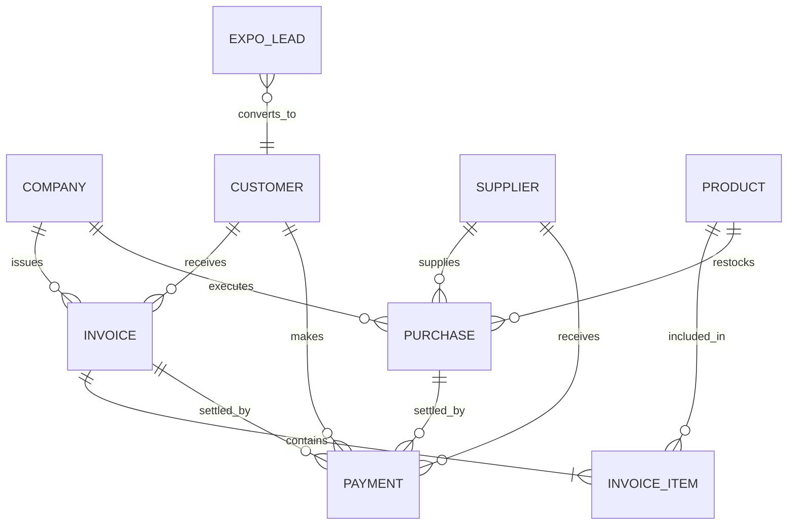

# LAXMI ENTERPRISES
## APPLICATION DEVELOPMENT REQUIREMENTS
### Developer Handover & System Specification Document

**Purpose:** This document converts the business and system requirements of **Laxmi Enterprises** into a structured, production-ready development specification. Developers, architects, and quality assurance engineers should use this document as the primary checklist while designing, developing, testing, enhancing, and delivering the application.

---

## 1. Development Focus

The application is primarily a comprehensive business management and Enterprise Resource Planning (ERP) portal for **Laxmi Enterprises**. The central focus is the seamless, reliable, and auditable handling of customer and supplier records, purchase and sales transactions, GST tax calculations, payment tracking with partial settlements, invoices, expenses, financial reports, and agricultural exhibition (Expo) lead capture.

### Core Principles:
- **Automatic & Reliable Financial Calculations:** All totals, subtotals, CGST/SGST/IGST tax breakdowns, discounts, and outstanding balances must compute deterministically and update reactively across screens.
- **Unified Transaction Graph:** Purchase, sales, invoice, payment, and outstanding records must remain strictly interconnected rather than isolated forms.
- **Single Source of Truth:** Users should never have to re-enter information repeatedly; client details, rates, and catalog entries auto-fill into transaction vouchers.
- **Financial Record Safety:** Financial transactions must **not** have an unrestricted permanent-delete option. Immutable ledgers, soft cancellations, and audit trails safeguard business accounting.
- **Intuitive Usability:** Designed for day-to-day business staff and field agents with responsive layouts, clear visual badges, and minimal learning curve.
- **Standard Digital Reports & PDF Export:** All transaction documents and operational registers support direct viewing, printing, and high-fidelity PDF generation.

---

## 2. Suggested Main Navigation

The web application structure is organized into dedicated functional modules accessible via the collapsible primary sidebar (`src/App.jsx`):

| Navigation Item | Route | Icon | Description & Scope | Codebase Reference |
|---|---|---|---|---|
| **Dashboard** | `/` | `LayoutDashboard` | Executive overview, operational KPIs, revenue trajectory, and inventory health | [`Dashboard`](file:///c:/Users/Chaitrali%20Shevtekar/Downloads/laxmi-enterprises-frontend/src/App.jsx#L993) |
| **Customers / Clients** | `/clients` | `Users` | Master directory of Farmers, Animal Feed Shops, and Dairies with village mapping | [`ClientsPage`](file:///c:/Users/Chaitrali%20Shevtekar/Downloads/laxmi-enterprises-frontend/src/App.jsx#L2080) |
| **Suppliers** | `/clients` / `/purchases` | `Building2` | Supplier profiles, procurement contacts, credit terms, and inward history | [`PurchasesPage.jsx`](file:///c:/Users/Chaitrali%20Shevtekar/Downloads/laxmi-enterprises-frontend/src/components/PurchasesPage.jsx) |
| **Products** | `/products` | `Package` | Product master, HSN codes, categories, selling prices, and reorder levels | [`ProductsPage`](file:///c:/Users/Chaitrali%20Shevtekar/Downloads/laxmi-enterprises-frontend/src/App.jsx#L4250) |
| **Purchases** | `/purchases` | `ShoppingCart` | Inward procurement vouchers, vendor bills, GST inputs, and payment states | [`PurchasesPage.jsx`](file:///c:/Users/Chaitrali%20Shevtekar/Downloads/laxmi-enterprises-frontend/src/components/PurchasesPage.jsx) |
| **Sales** | `/invoices` | `Receipt` | Commercial sales orders, customer billings, itemized dispatches | [`InvoicesPage.jsx`](file:///c:/Users/Chaitrali%20Shevtekar/Downloads/laxmi-enterprises-frontend/src/components/InvoicesPage.jsx) |
| **Payments** | `/revenue` / Modals | `IndianRupee` | Inflow/outflow tracking, payment modes (RTGS/NEFT/UPI/Cash), partial receipts | [`Revenue`](file:///c:/Users/Chaitrali%20Shevtekar/Downloads/laxmi-enterprises-frontend/src/App.jsx#L3668) |
| **Expenses** | `/revenue` | `TrendingDown` | Operating overheads, warehouse expenses, logistics, and audit trails | [`Revenue`](file:///c:/Users/Chaitrali%20Shevtekar/Downloads/laxmi-enterprises-frontend/src/App.jsx#L3668) |
| **Invoices** | `/invoices` | `FileText` | GST tax invoices, printable PDF vouchers, itemized billing registers | [`InvoicesPage.jsx`](file:///c:/Users/Chaitrali%20Shevtekar/Downloads/laxmi-enterprises-frontend/src/components/InvoicesPage.jsx) |
| **Expo Leads** | `/expo` | `MessageCircle` | Exhibition visitor capture, Kisan Mela leads, and bulk WhatsApp broadcast | [`ExpoPage.jsx`](file:///c:/Users/Chaitrali%20Shevtekar/Downloads/laxmi-enterprises-frontend/src/components/ExpoPage.jsx) |
| **Reports & Cloud** | `/data-hub` / `/revenue` | `Cloud` | Sales, Purchase, Client Outstanding ledgers, and Google Drive cloud backup | [`DataHubPage.jsx`](file:///c:/Users/Chaitrali%20Shevtekar/Downloads/laxmi-enterprises-frontend/src/components/DataHubPage.jsx) |
| **Settings / Profile** | `/workspace` | `ShieldCheck` | Corporate identity, GST settings, credential vault, security administration | [`AdminWorkspace`](file:///c:/Users/Chaitrali%20Shevtekar/Downloads/laxmi-enterprises-frontend/src/App.jsx#L5373) |

---

## 3. Company Profile & Branding

### Specifications:
- **Corporate Entity:** Laxmi Enterprises
- **Tagline:** Industrial Supplies, Hardware, Agro Supplies & Trading Portal
- **Brand Visuals:** Official high-resolution corporate logo (`/logo.png`) featuring the royal metallic slate-blue **L** high-rise architectural emblem, burnished champagne gold aerodynamic swoosh, and serif corporate typography.
- **Brand Color Palette:**
  - **Dominant Primary:** Sapphire Deep Blue (`#005bb5` / `#003870`)
  - **Prestige Accent:** Burnished Champagne Gold / Warm Amber (`#d4af37` / `#c59b27`)
  - **Technological Accent:** Electric Cyan (`#00b4d8`)
  - **Surface Canvas:** Daylight Crisp (`#f8fafc` / `#ffffff`) and Midnight Slate (`#090e17` / `#0f192b`)
- **Configurable Corporate Details (Settings / Admin Workspace):**
  - Company Legal Name (`company.name`)
  - Registered Corporate Address (`company.address`)
  - GSTIN Identification (`company.gstin`: e.g., `27AAACL1234F1Z5` - Maharashtra State Code 27)
  - Permanent Account Number (`company.pan`: e.g., `AAACL1234F`)
  - Contact Phone (`company.phone`) & Support Email (`company.email`)
  - Banking Remittance Credentials (Bank Name, Account Number, IFSC Code, Branch) for auto-inclusion in PDF Invoices.

---

## 4. Dashboard

The executive dashboard provides business owners and managers with a real-time snapshot of enterprise performance, operational alerts, and instant action shortcuts:

### Key Performance Indicators (KPIs):
- **Total Customers / Clients:** Live count categorized by tier and segment.
- **Total Suppliers:** Active procurement vendors.
- **Today's / Monthly Sales Volume:** Gross commercial billing with month-over-month trajectory (`AreaChart`).
- **Purchases & Inward Procurement:** Total expenditure on stock intake.
- **Cash Flow & Payments:** Breakdown of realized collections vs. pending receivables.
- **Outstanding Receivables (Customers):** Aggregated unpaid client balance.
- **Outstanding Payables (Suppliers):** Aggregated vendor balance due.
- **Inventory Health (Donut / PieChart):** Real-time ratio of in-stock items, low-stock reorder warnings, and stockouts.

### Quick Actions:
- **Add Sale / Create Tax Invoice** (Launches [`InvoiceModal.jsx`](file:///c:/Users/Chaitrali%20Shevtekar/Downloads/laxmi-enterprises-frontend/src/components/InvoiceModal.jsx))
- **Add Purchase Inward** (Launches [`PurchaseModal.jsx`](file:///c:/Users/Chaitrali%20Shevtekar/Downloads/laxmi-enterprises-frontend/src/components/PurchaseModal.jsx))
- **Add Customer / Client** (Launches Client Onboarding Modal)
- **Record Expense / Voucher**
- **Add Expo Lead** (Launches [`ExpoLeadModal.jsx`](file:///c:/Users/Chaitrali%20Shevtekar/Downloads/laxmi-enterprises-frontend/src/components/ExpoLeadModal.jsx))
- **Sync to Google Drive / Cloud Central**

---

## 5. Customer Management

The client module handles diverse commercial relationships across agricultural, retail, and industrial sectors with dedicated classification:

### Customer Categories:
1. **Farmers (`Farmers`):** Individual agricultural producers, dairy cattle owners, and farm operators.
2. **Shopkeepers (`Animal Feed Shop`):** Agro-dealers, feed distributors, veterinary agencies, and hardware stores.
3. **Dairy & Commercial Entities (`Dairy` / Other):** Milk producer cooperatives, bulk chilling centers (BMCs), and processing plants.

### Customer Fields & Data Schema:
- `id`: Unique identifier (e.g., `CL-001`, `CL-002`)
- `clientType`: Category (`Farmers` | `Animal Feed Shop` | `Dairy`)
- `name`: Business or proprietor full name
- `contactPerson`: Primary authorized contact person
- `contact`: Mobile phone number (10-digit Indian standard)
- `email`: Business email address
- `dob`: Date of birth / business establishment date
- `village`, `taluka`, `district`, `city`: Granular rural location mapping
- `productTypes`: Primary product lines purchased (e.g., Cattle Feed, Mineral Mixture)
- `companies` / `brands`: Preferred supplier brands (e.g., Godrej, Amul, Cargill)
- `numberOfAnimals` / `animalDetails`: Livestock count and breed details for farmers
- `numberOfSuppliers` / `milkQuantity`: Daily procurement volume for dairies
- `gstin`: Valid GSTIN registration number
- `tier`: Client rating (`Platinum` | `Gold` | `Silver`)
- `paymentTerms`: Commercial terms (`Immediate` | `Net 15` | `Net 30`)
- `outstanding`: Real-time unpaid ledger balance
- `orders` & `revenue`: Historical transaction count and gross value

### Core Functions:
- **Add & Edit:** Full modal workflows with validation.
- **Search & Filter:** Multi-attribute instant search by name, contact, village, taluka, category, and payment status.
- **Ledger & History:** Direct viewing of customer's linked invoices, payments, and balance.
- **Customer Statement Export:** Print or download statement as PDF.

---

## 6. Supplier Management

The supplier sub-system manages vendor procurement, price lists, and payment balances:

### Supplier Fields:
- Supplier Name & Company Name
- Authorized Representative & Contact Number
- Full Warehouse / Office Address
- GST Number (Mandatory for input tax credit claiming)
- Products / Raw Materials Supplied
- Contracted Unit Rates & Minimum Order Quantities (MOQ)
- Bank Account & IFSC details for NEFT/RTGS payments
- Cumulative Purchase Volume, Paid Amount, and Pending Payables
- Internal Remarks & Freight Terms

### Purchase Connection:
- Every supplier record is linked to inward purchases in [`PurchasesPage.jsx`](file:///c:/Users/Chaitrali%20Shevtekar/Downloads/laxmi-enterprises-frontend/src/components/PurchasesPage.jsx).
- Recording an inward purchase automatically increments the supplier's balance, while payments reduce outstanding payables.

---

## 7. Product Management

The product catalog serves as the central pricing and inventory master for both Purchases and Sales:

### Product Attributes:
- `id`: Unique SKU code (e.g., `PR-001`)
- `name`: Official commercial name (e.g., *Industrial Pipe Set*, *Godrej MilkMore 50kg*)
- `category`: Classification (*Hardware*, *Agro Supplies*, *Electrical*, *Mechanical*)
- `purchaseRate`: Default vendor inward price
- `sellingRate`: Benchmark customer sale price
- `gstRate`: Applicable GST bracket (0%, 5%, 12%, 18%, 28%)
- `hsnCode`: Harmonized System of Nomenclature code for tax compliance
- `unit`: Quantity unit (*Bags*, *Mtrs*, *Nos*, *Kg*, *Tonnes*)
- `stock` & `minStock`: Current warehouse stock and reorder threshold
- `status`: Active / Inactive / Discontinued

### Operational Behavior:
- When creating sales invoices or inward purchases, selecting a product auto-populates HSN codes, tax rates, standard units, and baseline rates, preventing manual typos.

---

## 8. Purchase Module

The procurement workflow handles inventory receipts and vendor billings:

$$\text{Purchase Flow: } \text{Supplier} \longrightarrow \text{Product} \longrightarrow \text{Quantity} \longrightarrow \text{Rate} \longrightarrow \text{GST} \longrightarrow \text{Total} \longrightarrow \text{Payment}$$

### Key Capabilities in [`PurchaseModal.jsx`](file:///c:/Users/Chaitrali%20Shevtekar/Downloads/laxmi-enterprises-frontend/src/components/PurchaseModal.jsx):
- **Vendor Selection:** Dropdown selector linking directly to registered suppliers/clients with auto-fill.
- **Category-Adaptive Fields:**
  - *Animal Feed:* Bag count, unit rate, supplier brands, silo bay inward.
  - *Dairy:* Fat percentage, SNF percentage, liters received, rate per liter.
  - *Farmers:* Silage bales, tonnage, fodder type.
- **GST Tax Computation:** Automatic calculation of Taxable Amount, GST Rate (5%, 12%, 18%), GST Value, and Gross Total.
- **Payment Method Support:** RTGS / Bank Transfer, UPI Commercial, Cash, Credit Purchase.
- **Settlement Modes:** Full Payment, Partial Payment, Credit / Unpaid.
- **Ledger Updates:** Automatically adjusts warehouse inventory in and supplier outstanding.
- **Voucher Generation:** View modal ([`PurchaseViewModal.jsx`](file:///c:/Users/Chaitrali%20Shevtekar/Downloads/laxmi-enterprises-frontend/src/components/PurchaseViewModal.jsx)) with printable slip and PDF download.

---

## 9. Sales Module

The sales engine drives customer order processing and invoice issuance:

$$\text{Sales Flow: } \text{Customer} \longrightarrow \text{Itemized Products} \longrightarrow \text{Rates \& Qty} \longrightarrow \text{GST Breakdown} \longrightarrow \text{Total} \longrightarrow \text{Payment Mode} \longrightarrow \text{Tax Invoice}$$

### Key Capabilities in [`InvoiceModal.jsx`](file:///c:/Users/Chaitrali%20Shevtekar/Downloads/laxmi-enterprises-frontend/src/components/InvoiceModal.jsx):
- **Customer Lookup:** Auto-fills customer billing address, village, GSTIN, and credit terms.
- **Itemized Multi-Row Billing:** Allows adding multiple products with custom HSN, quantities, and rates.
- **Real-Time Tax Calculation:** Computes item line totals, subtotal, CGST, SGST, IGST, and Grand Total.
- **Payment Terms:** Select immediate payment, partial advance, or Net credit period.
- **Direct Dispatch:** On save, automatically updates customer outstanding and generates standard invoice documents.

---

## 10. GST & Financial Calculation Rules

To ensure complete accounting integrity across Invoices, Purchases, and Reports, standard mathematical rules are enforced:

### Calculation Formulas:
1. **Line Item Taxable Amount:**
   $$\text{Taxable Amount} = \text{Quantity} \times \text{Unit Rate}$$
2. **Applicable GST Amount:**
   $$\text{GST Amount} = \text{Taxable Amount} \times \left(\frac{\text{GST Rate \%}}{100}\right)$$
3. **Intra-State GST Breakdown (Maharashtra Code 27):**
   $$\text{CGST} = \frac{\text{GST Amount}}{2}, \quad \text{SGST} = \frac{\text{GST Amount}}{2}$$
4. **Inter-State GST Breakdown (Outside Maharashtra):**
   $$\text{IGST} = \text{GST Amount}$$
5. **Grand Total:**
   $$\text{Grand Total} = \text{Taxable Subtotal} + \text{Total GST} + \text{Freight / Handling} - \text{Discount}$$
6. **Outstanding / Pending Balance:**
   $$\text{Pending Balance} = \text{Grand Total} - \text{Total Paid Amount}$$

*Calculations are performed at the system level. Manual overriding of computed totals is restricted.*

---

## 11. Partial Payment & Outstanding Tracking

**High-Priority Core Feature:** Flexible cash flow management without creating duplicate transactions.

### Workflow:
- **Partial Payment Recording:** When a transaction of ₹30,000 is settled with an initial receipt of ₹20,000, the system automatically flags the voucher as **Partial** with an outstanding balance of ₹10,000.
- **Subsequent Payment Receipts:** Future payments are recorded against the **existing transaction ID/Invoice ID**, updating the `paidAmount`, reducing `pendingAmount`, and appending payment timestamps.
- **Never Duplicate:** A secondary sale or purchase voucher is **never** created to record subsequent installment payments.
- **Client & Vendor Statements:** Display cumulative billed, cumulative paid, current pending, and payment chronological history in UI and PDF.

---

## 12. Invoice Management

Comprehensive GST-compliant Tax Invoices managed via [`InvoicesPage.jsx`](file:///c:/Users/Chaitrali%20Shevtekar/Downloads/laxmi-enterprises-frontend/src/components/InvoicesPage.jsx):

### Invoice Features:
- **Sequential Identifier:** Automated numbering (e.g., `LE-INV-2026-001`).
- **Official Branding:** High-resolution corporate logo, header accent bars, and verified company details.
- **Customer & Consignee Details:** Legal name, address, GSTIN, State code, and contact.
- **Itemized Table:** Description, HSN Code, Quantity, Unit, Rate, Taxable Value, GST %, Line Total.
- **Amount in Words:** Automated Indian Rupee currency words conversion (crore, lakh, thousand, hundred) implemented via [`numberToWordsINR`](file:///c:/Users/Chaitrali%20Shevtekar/Downloads/laxmi-enterprises-frontend/src/services/pdfService.js#L7).
- **Bank & Remittance Details:** Bank name, account number, IFSC code, and branch for RTGS/NEFT/IMPS payments.
- **Legal Terms & Digital Seal:** Standard terms of sale, Pune jurisdiction clause, and authorized signatory signature placeholder.
- **Document Output:**
  - Download Vector PDF via [`generateInvoicePDF`](file:///c:/Users/Chaitrali%20Shevtekar/Downloads/laxmi-enterprises-frontend/src/services/pdfService.js#L57).
  - Modal preview and printable invoice view via [`InvoiceViewModal.jsx`](file:///c:/Users/Chaitrali%20Shevtekar/Downloads/laxmi-enterprises-frontend/src/components/InvoiceViewModal.jsx).

---

## 13. Expense Module & Audit Controls

Business operating overheads (freight, utilities, warehouse rent, labor, vehicle fuel):

### Expense Attributes:
- Expense Voucher ID
- Expense Category (*Logistics & Freight*, *Warehouse Maintenance*, *Staff & Field Operations*, *Utilities & Office*, *Marketing & Expo*)
- Amount (INR)
- Payment Method & Reference Number
- Incurred Date & Staff Member
- Description / Remarks & Attached Receipt Reference

### Strict Deletion Policy:
- **No Permanent Delete Option for Normal Users:** In accordance with financial compliance rules, financial expenses cannot be deleted with a single click.
- **Reversal / Inactive Flagging:** To correct an entry, authorized users apply an "Edit" correction or mark the record as "Cancelled / Reversed" with an audit explanation.
- **Expense Reports:** Available as printable on-screen registers and exportable PDF summaries.

---

## 14. WhatsApp Payment & Lead Messaging

Instant customer communication via direct WhatsApp deep-links without recurring API fees:

### Implementation in [`whatsappService.js`](file:///c:/Users/Chaitrali%20Shevtekar/Downloads/laxmi-enterprises-frontend/src/services/whatsappService.js):
- **E.164 Number Normalization:** Converts Indian 10-digit mobile numbers (e.g., `9822456789`) to international WhatsApp format (`919822456789`) via [`normalizeWhatsAppNumber`](file:///c:/Users/Chaitrali%20Shevtekar/Downloads/laxmi-enterprises-frontend/src/services/whatsappService.js#L50).
- **Payment Acknowledgment Message:**
  > *"Namaskar [Customer Name] ji! 🙏 Laxmi Enterprises acknowledges receipt of ₹[Amount Paid] against Invoice #[Invoice ID]. Current Outstanding Balance: ₹[Remaining Balance]. Thank you for your business! 📞 +91 98765 43210"*
- **Exhibition Lead Follow-Up Templates:**
  - Stall Welcome & Thank You
  - Animal Feed Shop Wholesale Rate Inquiry
  - Dairy BMC Procurement Follow-up
  - Farmer Direct Fodder & Silage Dispatch
- **vCard Address Book Export:** Generates standard `.vcf` contact cards via [`generateVCardString`](file:///c:/Users/Chaitrali%20Shevtekar/Downloads/laxmi-enterprises-frontend/src/services/whatsappService.js#L109) to import entire lead cohorts into mobile address books for WhatsApp Broadcast Lists.

---

## 15. Expo / Exhibition Leads

Dedicated module for trade shows, Krishi Melas, and agricultural expositions ([`ExpoPage.jsx`](file:///c:/Users/Chaitrali%20Shevtekar/Downloads/laxmi-enterprises-frontend/src/components/ExpoPage.jsx)):

### Lead Attributes:
- `id`: Sequential lead code (e.g., `EXP-001`)
- `name`: Visitor / Farmer / Dealer name
- `mobile`: Contact telephone number
- `village`, `taluka`, `district`: Geographic origin
- `expoName`: Event identifier (e.g., *Kisan Agri Expo 2026 - Pune*, *Maha Dairy Mela 2026*)
- `category`: Visitor profile (*Farmers* | *Animal Feed Shop* | *Dairy* | *General*)
- `remark`: Visitor specific inquiries and stock requirements
- `date`: Registration timestamp
- `status`: Lifecycle stage (*New Lead* | *Followed Up* | *Interested* | *Converted*)

### Functionality:
- Rapid registration form via [`ExpoLeadModal.jsx`](file:///c:/Users/Chaitrali%20Shevtekar/Downloads/laxmi-enterprises-frontend/src/components/ExpoLeadModal.jsx).
- Bulk WhatsApp broadcast modal via [`WhatsAppBulkModal.jsx`](file:///c:/Users/Chaitrali%20Shevtekar/Downloads/laxmi-enterprises-frontend/src/components/WhatsAppBulkModal.jsx).
- Multi-criteria filtering by Expo name, date, sector, and conversion state.
- Downloadable vCard `.vcf` phone address book import and printable PDF reports.

---

## 16. Reports & Export

Standard digital reporting and PDF document generation in [`pdfService.js`](file:///c:/Users/Chaitrali%20Shevtekar/Downloads/laxmi-enterprises-frontend/src/services/pdfService.js):

### Core Reports Available:
1. **Sales & Commercial Invoices Report:** Itemized sales volumes, tax collections, payment breakdown.
2. **Purchases & Procurement Inward Report:** Vendor billings, input tax credit, and stock movements.
3. **Customer Outstanding & Aging Report:** Overdue accounts, credit days, and payment history.
4. **Supplier Payables Report:** Pending vendor commitments.
5. **Inventory Valuation & Movement Audit:** Warehouse SKU stock, low-stock alerts, bin locations.
6. **Expo Leads & Conversion Register:** Visitor inquiries, contact details, and follow-up logs.
7. **Customer & Supplier Statements:** Detailed chronological transaction statements printable or exportable as PDF.

### Filters:
- Date Ranges: Today, This Week, This Month, Fiscal Quarter, Full Financial Year, Custom Range.

---

## 17. Search, Filters & Usability

- **Global & Section-Level Search:** Real-time character-by-character search across clients, phone numbers, villages, invoices, bill numbers, and products.
- **Categorical Chips & Status Badges:** Color-coded status tags for **Paid** (Green), **Partial** (Amber), and **Pending/Overdue** (Red).
- **Responsive Navigation:** Mobile-friendly sidebar drawer with smooth touch interactions, auto-closing mobile menus, and desktop multi-column layouts.
- **Theme Personalization:** Clean Corporate Daylight mode and Executive Midnight Dark mode.

---

## 18. Data Relationships & Schema Architecture

All entities operate in a connected relational graph:

- $\text{Customer} \longrightarrow \text{Sales/Invoices} \longrightarrow \text{Payments} \longrightarrow \text{Outstanding Balance}$
- $\text{Supplier} \longrightarrow \text{Purchases} \longrightarrow \text{Payments} \longrightarrow \text{Outstanding Balance}$
- $\text{Product} \longrightarrow \text{Purchases (Inward Stock)} + \text{Sales (Outward Stock)}$
- $\text{Expo Lead} \longrightarrow \text{Direct WhatsApp Campaign} \longrightarrow \text{Customer Conversion}$

---

## 19. Financial Record Safety

1. **No Bulk Delete / "Delete All" Buttons:** Safeguard against accidental or catastrophic data wipes.
2. **Controlled Modifications:** Deletion of invoices and purchases requires explicit confirmation modals with visual warning badges.
3. **Audit Trail Logging:** User logins, sessions, and activity logs are tracked in [`authService.js`](file:///c:/Users/Chaitrali%20Shevtekar/Downloads/laxmi-enterprises-frontend/src/services/authService.js) and can be audited in the Credentials Ledger.
4. **Cloud Backup Vault:** Automated Google Drive cloud synchronization via [`googleDriveService.js`](file:///c:/Users/Chaitrali%20Shevtekar/Downloads/laxmi-enterprises-frontend/src/services/googleDriveService.js) archives system snapshots securely.

---

## 20. Suggested Database Entities

| Entity Name | Primary Purpose | Key Fields | Important Relationships |
|---|---|---|---|
| **Company** | Corporate identity & legal settings | `name`, `gstin`, `pan`, `address`, `phone`, `email`, `bankDetails` | Master configuration for invoices, reports, headers |
| **Customer** | Client master (Farmers, Shops, Dairies) | `id`, `name`, `clientType`, `contact`, `village`, `taluka`, `outstanding` | Parent to Invoices, Sales, Payments |
| **Supplier** | Procurement vendor master | `id`, `name`, `contact`, `gstin`, `address`, `productsSupplied`, `payables` | Parent to Inward Purchases, Vendor Payments |
| **Product** | Master product catalog & SKUs | `id`, `name`, `category`, `price`, `stock`, `minStock`, `hsn`, `unit` | Child of Purchases; Line items in Invoices |
| **Purchase** | Inward purchase transactions | `id`, `billNumber`, `vendorName`, `taxableAmount`, `gstAmount`, `paidAmount`, `balanceDue` | Links to Supplier, Products, Inventory In |
| **Invoice / Sale** | Outward sales transactions | `id`, `clientName`, `clientId`, `date`, `amount`, `tax`, `total`, `status`, `paymentMethod` | Links to Customer, Products, Accounts Receivable |
| **Payment** | Inflow / outflow voucher receipts | `id`, `refId`, `entityType`, `amount`, `mode`, `date`, `receiptNumber` | Settles Invoices and Purchases; updates balances |
| **Expense** | Overhead business expenses | `id`, `category`, `amount`, `date`, `paymentMethod`, `remarks`, `receipt` | Feeds into Profit & Loss and Financial Statements |
| **ExpoLead** | Exhibition visitor contacts | `id`, `name`, `village`, `mobile`, `expoName`, `category`, `status`, `remark` | Converted into Customer records; targeted in WhatsApp campaigns |
| **UserCredential** | Enterprise staff role & access | `id`, `username`, `passwordHash`, `name`, `role`, `status`, `lastLogin` | Authorizes operations and audits activity |

---

## 21. Development Priority & Implementation Matrix

| Priority Level | Scope & Feature | Detailed Requirements | Codebase Status |
|---|---|---|:---:|
| **P0 — Must Have** | **Customer Management** | Farmer, Shopkeeper, Dairy classification, village mapping, outstanding balance | **Implemented** |
| **P0 — Must Have** | **Supplier & Purchases** | Inward bill capture, category-specific agro fields, GST calculation, payments | **Implemented** |
| **P0 — Must Have** | **Product & Inventory** | SKU catalog, selling prices, warehouse levels, low-stock alerts | **Implemented** |
| **P0 — Must Have** | **Sales & Invoices** | Multi-item billing, CGST/SGST/IGST breakdown, payment status, terms | **Implemented** |
| **P0 — Must Have** | **GST Tax Engine** | Automatic 5%, 12%, 18% calculation, taxable base, grand total | **Implemented** |
| **P0 — Must Have** | **Partial Payments** | Tracking partial settlements without duplicate records, remaining balance | **Implemented** |
| **P0 — Must Have** | **Executive Dashboard** | Real-time KPIs, revenue charts, stock health donut, quick action shortcuts | **Implemented** |
| **P1 — Important** | **PDF Invoice Generator** | Professional vector PDF with logo, bank details, currency in words, tax grid | **Implemented** |
| **P1 — Important** | **Digital Reports & Statements** | Customer & Supplier statements, accounts receivable/payable registers | **Implemented** |
| **P1 — Important** | **WhatsApp Integration** | Normalized phone numbers, pre-filled agro templates, bulk vCard download | **Implemented** |
| **P1 — Important** | **Expo Leads Module** | Visitor capture, Krishi Mela tracking, category filters, campaign broadcast | **Implemented** |
| **P1 — Important** | **Cloud Synchronization** | Google Drive cloud backup, automated sync simulation, file vault management | **Implemented** |
| **P1 — Important** | **Expense Ledger** | Overhead expense recording, category breakdowns, deletion protections | **Designed** *(Ready for backend)* |
| **P2 — Additional** | **Role-Based Auth & RBAC** | Multi-role logins (Super Admin, Warehouse, Sales, Accounts), session vault | **Implemented** |
| **P2 — Additional** | **Production Backend API** | Node.js + Express REST API endpoints with persistent MongoDB/PostgreSQL | *Next Phase* |

---

## 22. Developer Testing Checklist

Before deploying or delivering new builds, verify each checklist item:

- [x] **Full-Payment Sale:** Create an invoice with status "Paid"; verify realized collections increment and client outstanding remains zero.
- [x] **Partial-Payment Sale:** Create an invoice with partial payment; verify status is "Partial" and pending balance reflects exact difference.
- [x] **Subsequent Payment Addition:** Record a second payment against the same invoice; verify outstanding balance recalculates without creating a duplicate invoice.
- [x] **Supplier Inward Purchase with GST:** Add purchase with 5% GST; verify taxable + GST = total amount and inventory receives units.
- [x] **Vendor Credit Purchase:** Create unpaid purchase; verify supplier outstanding shows full liability.
- [x] **Expense Safety:** Verify normal users do not have an unrestricted permanent delete action on financial records.
- [x] **Tax Invoice PDF Output:** Generate invoice PDF; verify company logo renders, currency words match total, and bank IFSC details are present.
- [x] **Digital Reports & Print:** Verify tabular records and financial ledgers render cleanly and print without layout overflow.
- [x] **WhatsApp Click-to-Chat:** Click WhatsApp button on an Expo Lead; verify number includes `91` prefix and template replaces `{{name}}` and `{{village}}`.
- [x] **Expo Lead Capture:** Add new visitor; verify entry appears in Expo table, filters by event, and exports to `.vcf`.
- [x] **Form Validation:** Submit empty forms; verify required field warnings prevent submission.
- [x] **Responsive Layout:** Test interface on mobile viewport (375px–430px); verify drawer menu, cards, and modal sheets are responsive.

---

## 23. Technical Specifications & Stack

- **Frontend Framework:** React 19 (`react`, `react-dom`) with Vite 6
- **Routing:** React Router 7 (`react-router-dom`)
- **Styling Architecture:** Modern Vanilla CSS Design System (`src/styles.css`) utilizing CSS custom properties, HSL theme tokens, backdrop-filters, and responsive flex/grid layouts.
- **Icons:** Lucide React (`lucide-react`)
- **Data Visualization:** Recharts (`recharts`) for responsive AreaCharts, BarCharts, and Donut PieCharts.
- **Document Generation:** `jspdf` & `jspdf-autotable` for vector PDF tax invoices.
- **State Management & Persistence:** Reactive React state synced with browser `localStorage`, with automated export and Google Drive cloud archival.
- **Build Tooling:** Vite v6.4.3 with ESBuild minification (`npm run build` / `npm run dev`).

---

## 24. Final Developer Instruction

Do not develop each screen as an isolated silo. Build the entire application around **connected business transactions**. 

The fundamental architectural requirement is that **Sales, Purchases, Customers, Suppliers, Payments, GST, Invoices, Expenses, and Outstanding Balances remain strictly synchronized**. Any modification to a transaction must deterministically update related ledgers, outstanding balances, warehouse stock, and analytical reports. 

Prior to production delivery, execute the end-to-end user journey:
$$\text{Customer Creation} \longrightarrow \text{Order/Invoice Creation} \longrightarrow \text{Partial Settlement} \longrightarrow \text{Subsequent Payment} \longrightarrow \text{PDF Document Generation}$$

---
*Document Version: 1.1.0 • Last Updated: October 2026 • Laxmi Enterprises Engineering*
